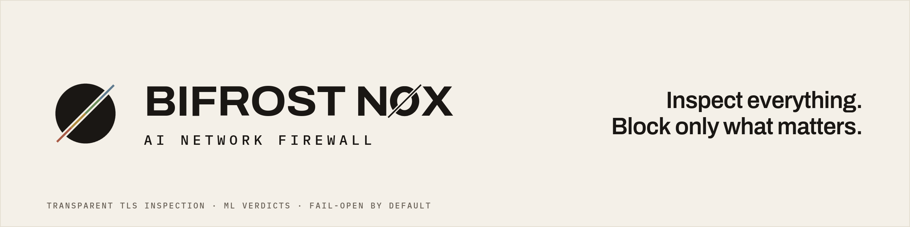
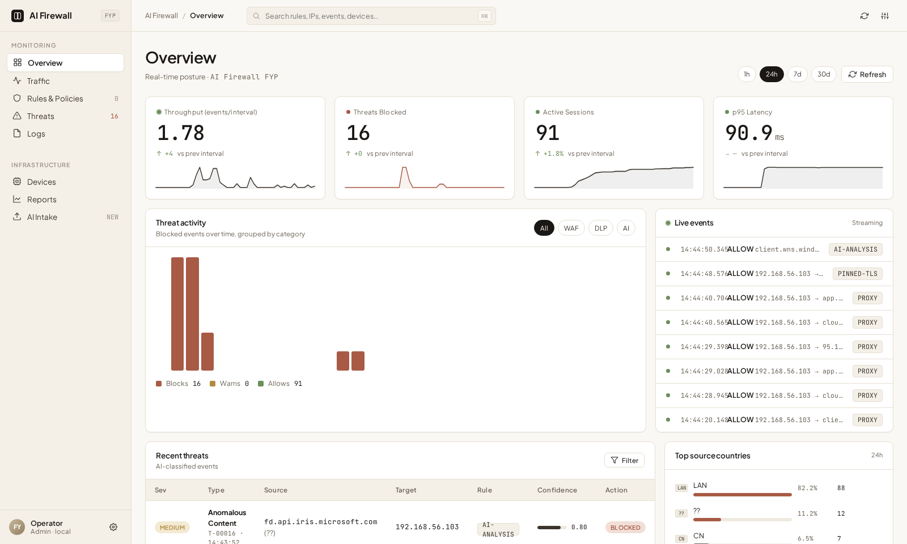
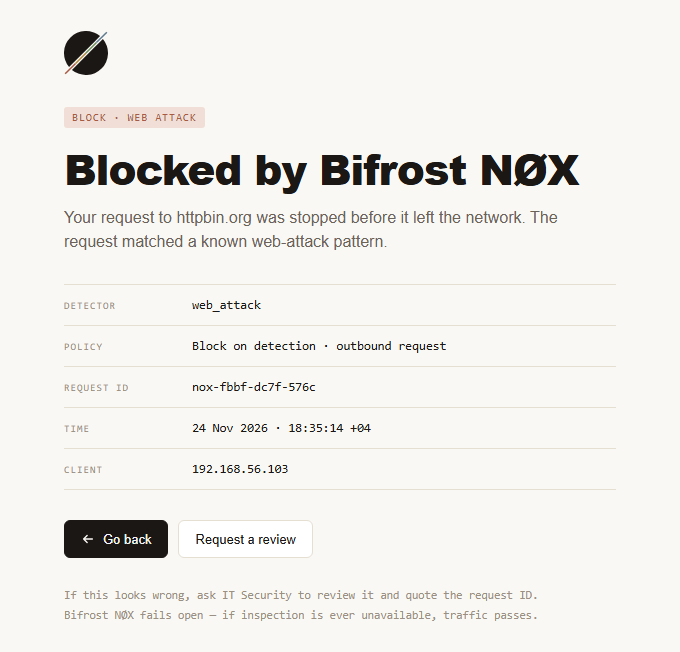

<p align="center">
  
</p>

<p align="center">
  
  
  
  
</p>

## What it does

Bifrost NØX is a transparent inspection firewall. It sits between a network and the internet, decrypts and inspects traffic with machine-learning detectors (web attacks, prompt injection, PII and secret leaks, malware in documents, unsafe images) and then allows or blocks it. It fails open by default, so it never gets in the way of normal browsing.

Built as a Final Year Project, it runs behind a Wi-Fi hotspot or in front of a VM lab.

| Dashboard | Block page |
|:---:|:---:|
|  |  |
| Live verdicts, threats, rules and AI file intake | What a user sees, with a request id IT can look up |

## How it works

```
client (phone / laptop / VM)
  │  through a Wi-Fi hotspot or a VM host-only network
  ▼
iptables ──┬── TCP 80/443 ──▶ MITM gateway :8080  (TLS interception)
           │                        │
           │                        ▼
           │                  orchestrator :8000 ──┬──▶ text     :8003
           │                                       ├──▶ image    :8001
           │                                       └──▶ document :8002
           └── DNS / FTP ───▶ C++ NFQUEUE engine ◀── ZeroMQ ──▶ AI brain
```

Every request and response gets an `ALLOW`, `BLOCK` or advisory `CENSOR` verdict, usually in well under a second. The text service runs the WAF, prompt-injection, secret and PII detectors; the image service runs CLIP, YOLOv8, OCR and steganography checks; the document service runs YARA, VirusTotal and structural analysis. Detectors only run where their question makes sense (prompt injection only on traffic bound for an LLM, for example), and low-confidence findings become dashboard warnings rather than blocks. The [detection policy](docs/detection.md) has the details.

## Highlights

- **Transparent TLS inspection.** Per-host certificates from a local CA; QUIC is refused so HTTP/3 cannot slip past.
- **Web-attack detection.** A DistilBERT classifier on request bodies and query values, plus precise signatures (Log4Shell, SSRF, XXE and more).
- **Data-loss prevention.** Vendor secrets and PII (Presidio), judged on evidence rather than entity type.
- **Prompt-injection defence** for traffic going to LLM APIs.
- **Images and documents.** Unsafe-image, OCR and steganography checks; malicious-document scanning.
- **DNS filtering** in a C++ NFQUEUE engine that fails open if its Python brain stops answering.
- **Operator tooling.** Real-time dashboard, rule engine, cert-pinned-app allowlist and a branded block page with request ids.

## Quick start

```bash
git lfs install && git clone https://github.com/CYC07/Bifrost-NOX.git && cd Bifrost-NOX
python3 -m venv venv && source venv/bin/activate
pip install -r requirements.txt && python -m spacy download en_core_web_lg
make -C network_inspector/cpp                   # C++ packet engine
(cd gateway && python3 cert_utils.py)           # local CA: install gateway/certs/ca.crt on clients
./start_all.sh                                  # hotspot mode; the VM lab is in docs/setup.md
```

Then open `http://localhost:8000/dashboard/`. System packages, models and the VM-lab setup are in [docs/setup.md](docs/setup.md).

Settings are environment variables (or a `.env` file). The ones most people change:

| Variable | Default | Effect |
|---|---|---|
| `AI_FAIL_MODE` | `open` | `closed` blocks traffic when analysis is unavailable |
| `DOC_SCAN_MODE` | `advisory` | `block` enforces document-scanner verdicts |
| `VIRUSTOTAL_API_KEY` | unset | enables hash lookups for documents |
| `FIREWALL_ADMIN_TOKEN` | unset | allows administration from another machine |
| `BLOCK_REVIEW_URL` | unset | where the block page's "Request a review" button points |

## Documentation

- **[Setup, running and testing](docs/setup.md)**: installation, models, hotspot and VM lab, dashboard, tests, project layout.
- **[Detection policy](docs/detection.md)**: what runs where, the secret, PII and trusted-domain policies, known limitations.
- **[Configuration](docs/configuration.md)**: every environment variable, the allowlist, VirusTotal, remote administration.

## Tech stack

PyTorch · Hugging Face Transformers (DistilBERT, DeBERTa-v3, CLIP) · YOLOv8 · Tesseract · Presidio · YARA · Starlette · ZeroMQ · C++17 / NFQUEUE · iptables · React 18

## Team

Final Year Project, BS Cyber Security, Riphah International University: Abdur Rafay Naveed, Alian Rafiq and Muhammad Shayan Faisal.

## License

Released under the MIT License.

> **Disclaimer:** a research prototype for controlled lab and hotspot environments, not hardened for production. Intercepting third-party traffic may be restricted where you are: only use it on networks you own or are explicitly allowed to monitor.
