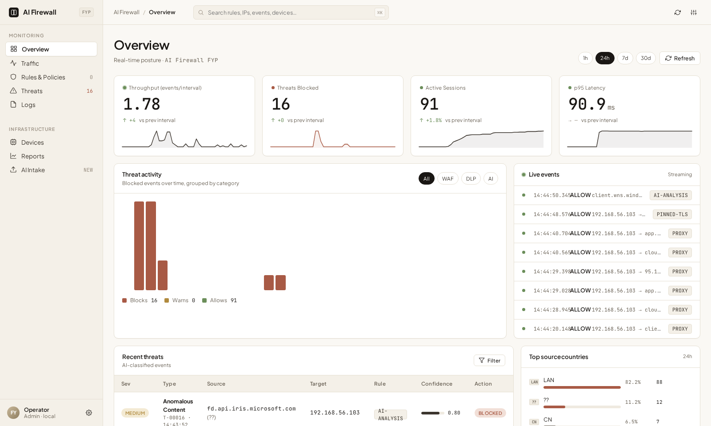
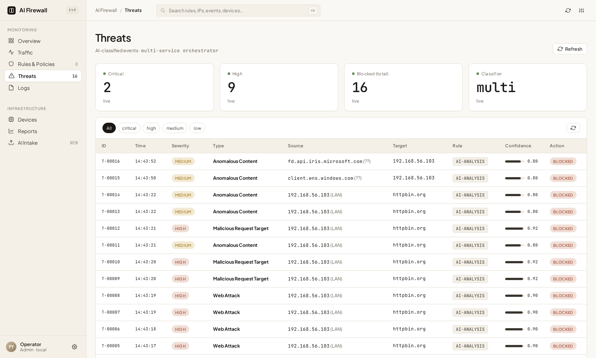
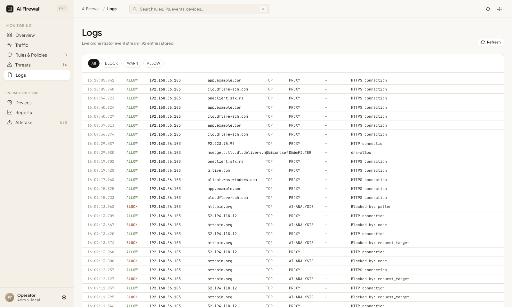
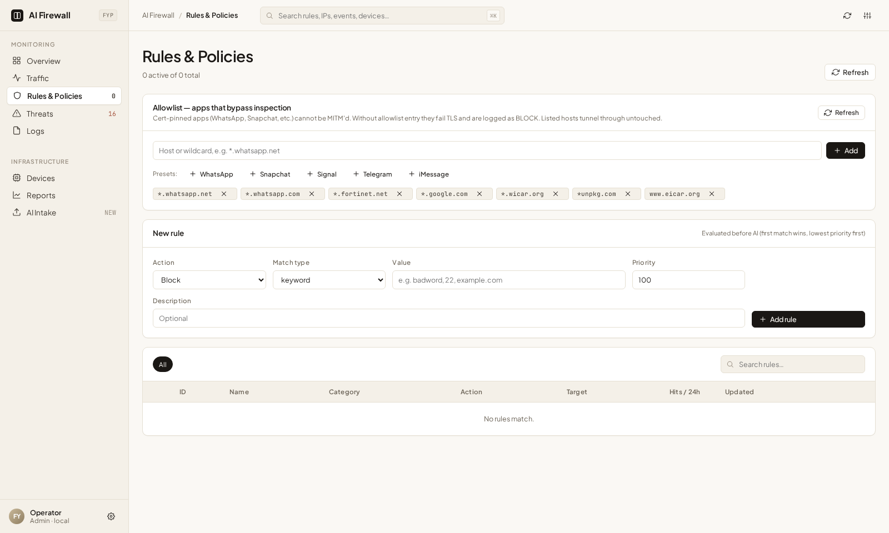
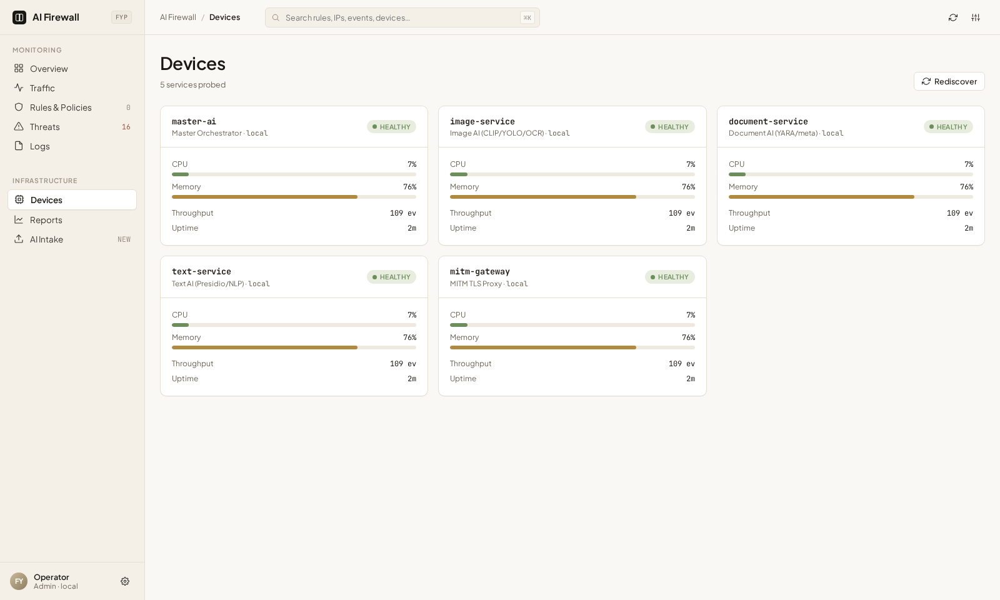

# Bifrost NØX — AI-Driven Network Firewall


An AI-powered transparent proxy firewall that intercepts, inspects, and classifies network traffic in real time using a pipeline of specialised machine-learning microservices. Built as a Final Year Project.



---

## Overview

Bifrost NØX sits between a client network (a Wi-Fi hotspot, or a VM host-only network) and the internet, intercepting HTTP and HTTPS traffic via a MITM proxy and iptables packet capture. Each request and response is analysed by one or more services — image classification, document scanning, and text/web-attack analysis — and an `ALLOW` / `BLOCK` / `CENSOR` (advisory) verdict is returned in well under a second.

```
Device (phone / laptop / VM)
        │
        ▼
  Hotspot (wlan1) or host-only net (vboxnet0)
        │  iptables REDIRECT / NFQUEUE
        ▼
  C++ Firewall Engine  ◄──ZeroMQ IPC──►  AI Brain (Python)        DNS filtering
        │
        ▼
  MITM Gateway (:8080)   TLS interception · SNI · allowlist bypass · request-target pre-filter
        │  body / request target / direction / host / path
        ▼
  Master AI Orchestrator (:8000) ── rules · stats · dashboard
        │
        ├── Text Service     (:8003)  secrets · PII · WAF · prompt-injection · sensitive content
        ├── Image Service    (:8001)  CLIP · YOLOv8 · OCR · stego · file safety
        └── Document Service (:8002)  YARA · VirusTotal · metadata · structural anomaly
```

---

## Design principle: availability over security

This is a gateway people have to be able to use. Every default favours not breaking legitimate traffic, and coverage is meant to grow over time.

- **Default-allow.** Traffic is blocked only on positive evidence of an attack. A request nobody recognises is allowed.
- **Fail-open.** If analysis is slow or an analyzer breaks, the request is allowed and the failure is logged loudly. `AI_FAIL_MODE=closed` flips this.
- **Advisory before blocking.** Lower-confidence findings are reported as `WARN` rows on the dashboard and never block.
- **Scoped analyzers.** A detector only runs where its question makes sense (see below), because several models were measured to false-positive at saturated confidence on ordinary web traffic, where no threshold can fix it.
- **Accepted gaps.** Obfuscated payloads with no active characters, SSRF/open-redirect values that are plain URLs, and paraphrased prompt injection outside LLM traffic are not blocked.

### What runs where

| Traffic | Analysis | Blocks when |
|---|---|---|
| **Request target** (path + query string, sent only when it looks interesting) | traversal / sensitive-file regex, secrets scan, WAF model on values with an *active* character (quotes, `<>;\|&$(){}`, `..`, SQL phrases; plain URLs and tokens are skipped) | signature hit, vendor secret, or WAF attack label ≥ threshold |
| **Outbound body** | secrets, PII patterns, prompt-injection signatures, then router → WAF (JSON scored value-by-value) or zero-shot sensitive-content | vendor secret, PII, WAF/sensitive hit |
| **Outbound body to an LLM endpoint** | all of the above + extracted message text scored by the prompt-injection model in overlapping windows; signature hits **block** | injection model ≥ threshold or signature |
| **Inbound reply** | secrets, PII and signatures (all advisory); zero-shot sensitive-content; the WAF and the injection model do **not** run | sensitive-content hit only |
| **Images** | CLIP multi-label, YOLOv8, OCR → secrets + PII, stego, file-safety guards | policy per group |
| **Documents** | YARA, VirusTotal hash lookup, metadata forensics, structural anomaly (Isolation Forest) | any engine blocks |

**Secret policy.** Outbound, vendor secrets that never belong on the wire (AWS keys, private keys, Stripe live keys, GitHub/Slack tokens, DB connection strings) block. Credentials that legitimately travel in requests and responses (JWTs, client-side Google API keys, a generic `password=`) are advisory. Inbound, everything is advisory.

**PII policy.** Presidio findings block on *evidence*, not on entity type. A US SSN blocks only at Presidio confidence ≥ `PII_MIN_SCORE` (0.4): a bare nine-digit id scores 0.05 and is ignored, a formatted SSN scores 0.5, and one with context ("ssn", "social security") 0.85. A Luhn-valid number always scores 1.0, so a credit card additionally needs card formatting (`4111 1111 1111 1111`) or a card-ish word just before it (`card`, `cvv`, `visa`, …); a bare Luhn-valid identifier is advisory. This was found by capturing live blocks: a Windows push-notification reply and an app login body were being blocked as "SSN" at confidence 0.05. Phone/email are informational only.

**Trusted domains.** Traffic to `microsoft.com`, `windows.com` and all their subdomains (`config/trusted_domains.json`, hot-reloaded) is treated as normal: TLS is tunnelled rather than intercepted, and no file-type block or model analysis runs. A firewall cannot see which *process* sent a packet, so "Windows' own processes" is approximated by "Windows' own domains". Matching is by DNS label: `evilmicrosoft.com` and `microsoft.com.evil.test` are not trusted, IP addresses never are, and attacker-registrable hosts such as `*.blob.core.windows.net` are deliberately not on the list. Trade-off: anything hosted under a trusted domain is invisible to the firewall, so keep the list narrow.

The name alone is never enough, because SNI and `Host` are set by the client. A connection is trusted only if **every name it presents is trusted** (SNI and `Host` must agree, which defeats domain fronting) **and the real destination IP is inside Microsoft's published ranges** (`config/microsoft_ip_ranges.json`, which defeats a spoofed SNI aimed at an attacker's server). Refresh the ranges with `python scripts/update_microsoft_ranges.py`. Known limits: the ranges include Azure address space, which anyone can rent, so spoofing now requires running a VM in Azure rather than setting a header; CDN-fronted Microsoft hosts (Akamai, Cloudflare; about 18 % of destinations in the lab) cannot be verified by IP and get normal inspection; a missing ranges file also means normal inspection. `TRUSTED_VERIFY_IP=0` restores name-only trust.

**LLM scope.** Prompt injection only matters for text that will reach an instruction-following model. Traffic is treated as LLM traffic when it is outbound **and** the host is in `config/llm_hosts.json`, the path ends in a known LLM API path (`/v1/chat/completions`, `/v1/messages`, …), or the JSON body looks like an LLM call (`model` + `messages`/`prompt`/`input`/`contents`). The list hot-reloads; add your company's internal LLM gateway there.

---

## Features

- **Transparent HTTPS interception** — MITM proxy with per-domain certificate generation; no client configuration needed behind the hotspot / host-only network
- **Web-attack detection** — a DistilBERT classifier (SQLi, XSS, path traversal, command injection, SSTI, scanner) applied to request bodies and the *values* of query strings and JSON, plus high-precision signatures for traversal and sensitive files
- **Prompt-injection defence for LLM traffic** — model + IDS-style signatures, scoped to LLM endpoints
- **Secrets / DLP** — vendor-specific regex with structural validation (JWT) and placeholder exclusion
- **PII and sensitive-content detection** — Presidio + a zero-shot NLI classifier for confidentiality
- **Image analysis** — CLIP multi-label + YOLOv8, OCR with secret/PII scanning, steganography and trailing-data checks
- **Document analysis** — YARA + VirusTotal hash lookup + structural anomaly detection + metadata forensics
- **Static rule engine** — IP/port/domain/keyword rules evaluated before AI inference; configurable from the dashboard
- **Allowlist for cert-pinned apps** — WhatsApp, Signal, Telegram etc. can tunnel through uninspected; everything else that fails MITM is blocked and logged as `PINNED-TLS`
- **DNS-layer filtering** — NFQUEUE path parses each DNS query against `config/dns_blocklist.json` and `domain` rules
- **Real-time dashboard** — KPI cards, threat feed, traffic charts, rule management, and AI file intake
- **Control-plane authentication** — state-changing endpoints and internal ingest require a loopback client or a valid `FIREWALL_ADMIN_TOKEN`
- **Hardened proxy** — refuses direct (non-redirected) connections instead of forwarding them to itself; binds only to the hotspot interface when one exists

---

## Architecture

| Layer | Component | Port / IPC |
|---|---|---|
| Packet capture | `network_inspector/cpp/firewall_engine` | NFQUEUE 1 |
| AI bridge | `network_inspector/ai_brain.py` | ZMQ `ipc:///tmp/firewall_pipeline` |
| MITM proxy | `gateway/proxy.py` + `mitm_engine.py` | :8080 |
| Orchestrator | `master_ai/orchestrator.py` | :8000 |
| Image AI | `image_service/main.py` | :8001 |
| Document AI | `document_service/main.py` | :8002 |
| Text AI | `text_service/main.py` | :8003 |
| Dashboard | `dashboard/` | `/dashboard/` on the orchestrator |

---

## Installation

```bash
git clone https://github.com/CYC07/Bifrost-NOX.git
cd Bifrost-NOX
```

### System dependencies

**Arch / BlackArch**
```bash
sudo pacman -S --needed base-devel python tesseract tesseract-data-eng \
    libnetfilter_queue libnfnetlink zeromq cppzmq perl-image-exiftool
# hotspot mode only:
sudo pacman -S --needed hostapd dnsmasq iptables-nft
```

**Debian / Kali / Ubuntu**
```bash
sudo apt update && sudo apt install -y build-essential g++ python3-dev python3-venv \
    tesseract-ocr libnetfilter-queue-dev libnfnetlink-dev libzmq3-dev libcppzmq-dev \
    libimage-exiftool-perl        # package names can differ slightly between releases
```

### Python environment

```bash
python3 -m venv venv && source venv/bin/activate
pip install -r requirements.txt            # CPU-only PyTorch via --extra-index-url
python -m spacy download en_core_web_lg    # Presidio's default NLP model
# if the download server is unavailable, install the wheel directly:
# pip install https://github.com/explosion/spacy-models/releases/download/en_core_web_lg-3.8.0/en_core_web_lg-3.8.0-py3-none-any.whl
```

> **Notes**
> - `requirements.txt` pins `starlette<1.0` (1.x removed the `on_startup=` argument the orchestrator uses) and installs `torch` **and** `torchvision` from the same CPU wheel index; mixing builds fails with `torchvision::nms does not exist`.
> - **fp16 gotcha:** `transformers>=5` loads some checkpoints in half precision, which is ~14× slower on CPU. The sensitive-content model is forced to fp32 in code; keep that if you swap models.

### Models

| Model | Source | First run |
|---|---|---|
| CLIP ViT-B/32, DeBERTa-v3 zero-shot NLI, prompt-injection DeBERTa | Hugging Face Hub | downloaded automatically (~2 GB total) |
| YOLOv8n | `yolov8n.pt` (gitignored) | place in the repo root or let ultralytics fetch it |
| **WAF classifier** | `ml/waf/artifacts/` (**gitignored**) | **you must train or supply it** |
| Content-shape router | `ml/router/artifacts/` (**gitignored**) | **you must train it** |

```bash
python -m ml.waf.build_dataset && python -m ml.waf.train     # baseline TF-IDF + LogReg
python -m ml.router.train
# or drop a Colab-trained DistilBERT into ml/waf/artifacts/waf_distilbert/
# (notebook: ml/waf/train_transformer.ipynb)
```

Without the WAF artifact the `web_attack` analyzer is disabled and everything else keeps working (fail-open); without the router every body is treated as a web request.

### Build the C++ engine and the CA

```bash
cd network_inspector/cpp && make && cd ../..
cd gateway && python3 cert_utils.py && cd ..      # creates the local CA; install gateway/certs/ca.crt on clients
```

---

## Running

### Full stack (hotspot mode)

Requires a Wi-Fi adapter in AP mode (`wlan1`). Start the hotspot first, then:

```bash
source venv/bin/activate
./start_all.sh
```

### Gateway + AI services only (no hotspot)

```bash
source venv/bin/activate
export PYTHONPATH=.

# AI microservices
uvicorn master_ai.orchestrator:app --host 0.0.0.0 --port 8000 &
uvicorn image_service.main:app     --host 0.0.0.0 --port 8001 &
uvicorn document_service.main:app  --host 0.0.0.0 --port 8002 &
uvicorn text_service.main:app      --host 0.0.0.0 --port 8003 &

# MITM proxy (transparent-only, see below)
python3 gateway/proxy.py
```

> The proxy is **transparent-only**: it needs traffic to arrive via an iptables `REDIRECT`. Pointing a browser at `127.0.0.1:8080` as an explicit proxy does not work; it answers `421 Misdirected Request`. To try it locally, redirect with iptables or use the lab setup below.

### Stop everything

```bash
sudo ./stop_all.sh
```

---

## Configuration

All settings are environment variables. `start_all.sh` sources a `.env` in the project root if present; when starting services by hand, `set -a; source .env; set +a` first.

| Variable | Default | Meaning |
|---|---|---|
| `AI_FAIL_MODE` | `open` | what to do when no verdict arrives: `open` allows, `closed` blocks (gateway **and** orchestrator) |
| `AI_TIMEOUT` | `10.0` | seconds the gateway waits for a verdict |
| `SERVICE_TIMEOUT` | `8.0` | seconds the orchestrator waits for each analysis service (keep below `AI_TIMEOUT`) |
| `TEXT_MAX_CONCURRENCY` | `2` | concurrent text analyses (worker threads) |
| `TEXT_CACHE_SIZE` | `2048` | verdict cache entries (identical bodies are analysed once) |
| `WAF_ATTACK_THRESHOLD` | `0.8` | text-service block cutoff for the WAF |
| `WAF_MAX_VALUES` / `WAF_MAX_VALUE_CHARS` | `64` / `2000` | caps for per-value scoring |
| `WAF_MODEL_PATH` | `ml/waf/artifacts/waf_distilbert` | joblib file or HF directory |
| `PROMPT_INJECTION_THRESHOLD` | `0.9` | injection-model block cutoff (LLM traffic only) |
| `PII_MIN_SCORE` | `0.4` | minimum Presidio confidence for an SSN/IBAN/card match to count |
| `TRUSTED_VERIFY_IP` | `1` | require a trusted-domain connection to land in Microsoft's IP ranges (`0` = name-only) |
| `SENSITIVE_THRESHOLD` / `SENSITIVE_LABELS` | `0.6` / built-in | zero-shot sensitive-content cutoff / label override |
| `IMAGE_MAX_CONCURRENCY`, `IMAGE_OCR_MAX_FRAMES`, `IMAGE_CLIP_MULTICROP`, `IMAGE_STEGO_STRICT` | `2`, `8`, off, off | image-service tuning |
| `HOTSPOT_IF` / `INTERNET_IF` | `wlan1` / other wlan | interfaces used by the start/stop scripts |
| `PROXY_BIND_IP` | auto | override the proxy bind address |
| `VIRUSTOTAL_API_KEY` | – | enables hash lookups in the document service |
| `FIREWALL_ADMIN_TOKEN` | – | remote administration token (see below) |

Edit `config/llm_hosts.json` (`hosts` and `paths`) to change what counts as LLM traffic; `config/allowed_apps.json` for cert-pinned apps; `config/dns_blocklist.json` for DNS filtering.

---

## Dashboard

Open `http://localhost:8000/dashboard/` after starting the stack.

| Page | Description |
|---|---|
| Overview | Live KPI cards, threat activity, live event stream, recent threats |
| Traffic | Throughput graphs, protocol breakdown, recent flows |
| Rules & Policies | Static rule engine and the cert-pinned-app allowlist |
| Threats | AI-classified threat log with severity and confidence |
| Logs | Raw event stream (`BLOCK` / `WARN` advisory / `ALLOW`) |
| Devices | Health of the analysis services and the gateway |
| Reports | Session summaries and export |
| AI Intake | Drag-and-drop file analysis (images, PDFs, documents) |

| | |
|---|---|
|  |  |
| **Threats** — severity, source/target, rule and confidence | **Logs** — every event with its verdict |
|  |  |
| **Rules & Policies** — rule engine and allowlist presets | **Devices** — service health |

---

## Allowlist (cert-pinned apps)

Apps like WhatsApp, Snapchat, Signal, and Telegram pin their TLS certificates and reject the proxy's locally-signed certificate. Without an allowlist entry these connections are **blocked** and logged as `PINNED-TLS`. Add the host pattern from **Rules & Policies**, or via the API:

```bash
curl -X POST http://localhost:8000/allowlist -H "Content-Type: application/json" -d '{"host": "*.whatsapp.net"}'
curl http://localhost:8000/allowlist
curl -X DELETE http://localhost:8000/allowlist/*.whatsapp.net
```

---

## VirusTotal integration

The document service hashes every scanned file (SHA-256) and queries VirusTotal. No file bytes are uploaded. With no key set the service runs YARA-only.

| Scenario | Score | Verdict |
|---|---|---|
| VT reports ≥ 1 malicious engine | 0.99 | BLOCK |
| 0 detections / not found / API unavailable | 0.0 | pass to YARA |

```bash
echo "VIRUSTOTAL_API_KEY=your_key_here" >> .env     # .env is gitignored
```

---

## Control-plane authentication

The orchestrator on `:8000` is reachable by clients, so admin actions are gated: `POST/DELETE /rules`, `/allowlist`, `/test_attack` and the internal ingest endpoints (`/analyze_traffic`, `/log_event`) accept only a **loopback client** or a valid admin token. Read-only dashboard GETs stay open.

```bash
echo "FIREWALL_ADMIN_TOKEN=$(openssl rand -hex 24)" >> .env
curl -X POST http://<firewall-ip>:8000/allowlist \
  -H "X-Admin-Token: $FIREWALL_ADMIN_TOKEN" -H "Content-Type: application/json" \
  -d '{"host": "*.example.com"}'
```

---

## Testing

```bash
source venv/bin/activate
PYTHONPATH=. pytest tests -q
```

Current baseline: **445 passed, 4 xfailed, 7 failed**.

- **4 xfailed** are known model limitations recorded as tests (two are `strict`, so the suite goes red if they ever start passing): the prompt-injection model flags the real example.com page, and the WAF still flags JSON values containing URLs / apostrophes.
- **7 failed** are all in `tests/test_image_service.py`: with `transformers>=5`, `CLIPModel.get_text_features()` returns a `ModelOutput` instead of a tensor, so the CLIP classifier fails to load (the service degrades; OCR/stego/file checks still run). The fix is a one-line `getattr(feats, "pooler_output", feats)` in `ml/image/clip_classifier.py`.
- Some tests are skipped when model artifacts are absent.

`tests/data/pi_eval.jsonl` is a small labelled attack/benign set used by the prompt-injection tests.

### Testing with a VM (host-only lab)

VirtualBox **NAT mode does not work** for this: NAT traffic is re-originated by the VirtualBox process, so it never traverses the host's `PREROUTING`/`FORWARD` chains and the REDIRECT never fires. Use a host-only network and make the host the gateway, exactly like the hotspot:

1. Create `vboxnet0` (`192.168.56.1/24`) with VirtualBox's DHCP server, and put the VM's adapter on it.
2. On the host: bring the interface up, `sysctl net.ipv4.ip_forward=1`, `iptables -t nat -A POSTROUTING -s 192.168.56.0/24 -o <uplink> -j MASQUERADE`, then `HOTSPOT_IF=vboxnet0 INTERNET_IF=<uplink> sudo ./start_network.sh`.
3. Stop `systemd-networkd`/NetworkManager from managing `vboxnet0` (a catch-all DHCP profile otherwise adds a bogus default route through it).
4. Install `gateway/certs/ca.crt` in the guest (Windows: `certutil -addstore -f Root ca.crt`; Android: "VPN and apps").
5. Keep the guest clock correct (leaf certs are valid from now − 1 day, but not further back), and on Windows use `curl --ssl-no-revoke` (Schannel hard-fails on certs with no revocation endpoint).

---

## Network topology

| Item | Hotspot mode | VM lab |
|---|---|---|
| Client interface | `wlan1` (AP) | `vboxnet0` |
| Subnet / gateway | `192.168.50.0/24` / `192.168.50.1` | `192.168.56.0/24` / `192.168.56.1` |
| SSID | FYP-AI-Firewall | – |
| Proxy port | 8080 | 8080 |
| Uplink | `eth0`/`wlan0` or USB tether | `wlan0`/`eth0` |

---

## Project structure

```
ai_firewall/
├── common/               # schemas, FileSniffer, allowlist, llm_scope (LLM-traffic detection)
├── config/               # rules, allowlist, DNS blocklist, llm_hosts (JSON)
├── dashboard/            # React 18 + Babel frontend (served by the orchestrator)
├── document_service/     # YARA + VirusTotal, metadata forensics, structural anomaly
├── gateway/              # MITM proxy, TLS engine, certificate authority, HTTP parser
├── image_service/        # CLIP, YOLOv8, Tesseract OCR
├── master_ai/            # orchestrator, rule engine
├── ml/
│   ├── waf/              # web-attack classifier + request-target inspection (target.py)
│   ├── router/           # content-shape router
│   ├── sensitive/        # zero-shot sensitive-content classifier
│   ├── prompt_injection/ # injection model, signatures, prompt extraction, HTML reduction
│   ├── secrets/          # secret patterns, validators, detector
│   └── image/            # CLIP labels/classifier, OCR scan, stego, file safety
├── network_inspector/    # C++ NFQUEUE engine + Python ZMQ bridge
├── text_service/         # analysis pipeline (secrets, PII, WAF, injection, sensitive)
├── tests/                # pytest suite + tests/data eval sets
├── docs/screenshots/     # README images
├── start_all.sh · start_network.sh · stop_all.sh
└── requirements.txt
```

---

## Known limitations

- **Request targets and bodies only.** Headers (cookies, `User-Agent`) and WebSocket frames are not inspected.
- **Pinned clients** (apps and SDKs that ignore the system CA store) cannot be inspected; they are blocked or allowlisted.
- **Traffic that never crosses the network** (a local LLM on the same machine) is invisible to a network firewall.
- **Model false positives remain** in places: the WAF on values containing URLs/apostrophes, and the zero-shot sensitive-content model on some prose (e.g. terms-of-service text). They are tracked as xfail tests or open issues rather than hidden by thresholds.
- **IBAN detection is unverified:** Presidio's IBAN recognizer did not match well-formed test IBANs in our probes, so don't rely on IBAN blocking.
- **Prompt-injection signatures are a tripwire**, not a defence: paraphrases get through outside LLM scope (recall ≈ 83 % on the bundled eval set, 0 false positives on its benign items).
- **Long prompts:** only up to 16 windows of 1,500 characters are scored, so an injection in the middle of a very large (>~16 KB) prompt can be missed.
- Single-process services; sized for a lab / small network, not for production load.

---

## Tech stack

**AI / ML:** PyTorch (CPU) · Hugging Face Transformers · DistilBERT · DeBERTa-v3 · CLIP · YOLOv8 (ultralytics) · Tesseract OCR · sentence-transformers · Presidio · spaCy · YARA · scikit-learn · VirusTotal API

**Backend:** Python 3.11+ · Starlette · uvicorn · httpx · ZeroMQ · cryptography

**Network:** iptables · NFQUEUE · C++17 · libnetfilter-queue · Scapy

**Frontend:** React 18 · Babel standalone · custom CSS design system (no framework)

---

## License

Released under the MIT License.

> **Disclaimer:** This project is a research prototype built for a controlled lab/hotspot environment. It is not hardened for production deployment. MITM inspection of third-party traffic may be subject to legal restrictions in your jurisdiction — only use it on networks you own or have explicit permission to monitor.
