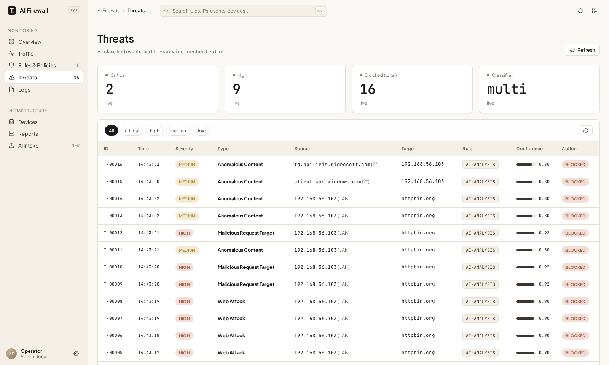
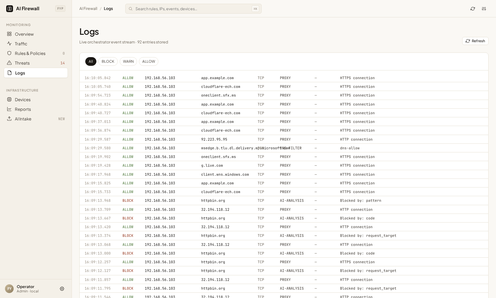
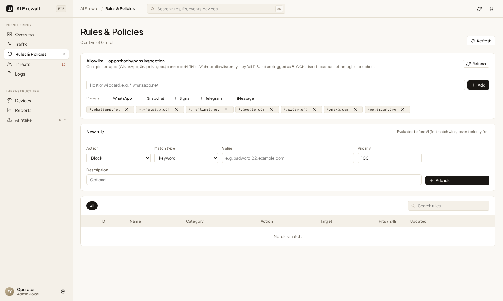
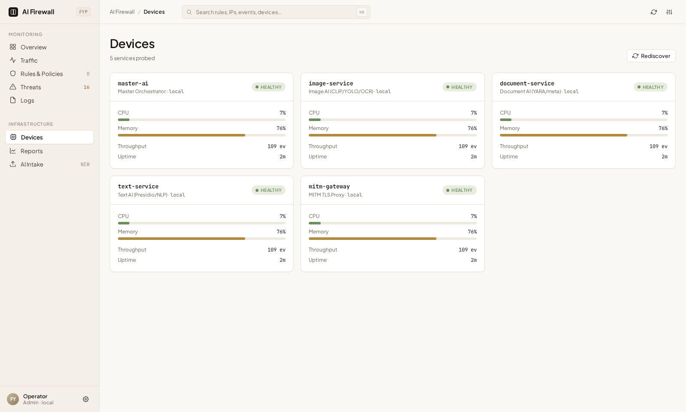

# Setup, running and testing

Installation, the hotspot and VM-lab setups, the dashboard, tests and the source layout. Back to the [README](../README.md).

## Components

| Layer | Component | Port / IPC |
|---|---|---|
| Packet capture | `network_inspector/cpp/firewall_engine` | NFQUEUE 1 |
| AI bridge | `network_inspector/ai_brain.py` | ZMQ `ipc:///tmp/firewall_pipeline` |
| MITM proxy | `gateway/proxy.py` + `mitm_engine.py` | :8080 |
| Orchestrator | `master_ai/orchestrator.py` | :8000 |
| Image AI | `image_service/main.py` | :8001 |
| Document AI | `document_service/main.py` | :8002 |
| Text AI | `text_service/main.py` | :8003 |
| Dashboard | `dashboard/` | `/dashboard/` on the orchestrator |

## Installation

```bash
git lfs install          # the WAF model weights are stored with Git LFS
git clone https://github.com/CYC07/Bifrost-NOX.git
cd Bifrost-NOX
```

### System dependencies

**Arch / BlackArch**
```bash
sudo pacman -S --needed base-devel python tesseract tesseract-data-eng \
    libnetfilter_queue libnfnetlink zeromq cppzmq perl-image-exiftool
# hotspot mode only:
sudo pacman -S --needed hostapd dnsmasq iptables-nft
```

**Debian / Kali / Ubuntu**
```bash
sudo apt update && sudo apt install -y build-essential g++ python3-dev python3-venv \
    tesseract-ocr libnetfilter-queue-dev libnfnetlink-dev libzmq3-dev libcppzmq-dev \
    libimage-exiftool-perl        # package names can differ slightly between releases
```

### Python environment

```bash
python3 -m venv venv && source venv/bin/activate
pip install -r requirements.txt            # CPU-only PyTorch via --extra-index-url
python -m spacy download en_core_web_lg    # Presidio's default NLP model
# if the download server is unavailable, install the wheel directly:
# pip install https://github.com/explosion/spacy-models/releases/download/en_core_web_lg-3.8.0/en_core_web_lg-3.8.0-py3-none-any.whl
```

> **Notes**
> - `requirements.txt` pins `starlette<1.0` (1.x removed the `on_startup=` argument the orchestrator uses) and installs `torch` **and** `torchvision` from the same CPU wheel index; mixing builds fails with `torchvision::nms does not exist`.
> - **fp16 gotcha:** `transformers>=5` loads some checkpoints in half precision, which is ~14× slower on CPU. The sensitive-content model is forced to fp32 in code; keep that if you swap models.

### Models

| Model | Source | First run |
|---|---|---|
| CLIP ViT-B/32, DeBERTa-v3 zero-shot NLI, prompt-injection DeBERTa | Hugging Face Hub | downloaded automatically (~2 GB total) |
| YOLOv8n | `yolov8n.pt` (gitignored) | place in the repo root or let ultralytics fetch it |
| **WAF classifier** (v3 DistilBERT) | `ml/waf/artifacts/waf_distilbert/` (Git LFS) | comes with the clone when Git LFS is installed |
| Content-shape router | `ml/router/artifacts/` (**gitignored**) | **you must supply it** (optional) |

The WAF model ships with the repo via Git LFS; the router and all datasets do not (training tooling is in `dataset_tools/`). To use your own:

- **WAF:** a Hugging Face sequence-classification directory at `ml/waf/artifacts/waf_distilbert/` whose
  `config.id2label` follows `ml/waf/taxonomy.py` (`clean, sqli, xss, path_traversal, command_injection, ssti,
  scanner`), tokenised at `max_length=256`; or a scikit-learn pipeline `.joblib` with the same labels.
  `WAF_MODEL_PATH` selects it and `WAF_ATTACK_THRESHOLD` (default `0.99`) sets the decision threshold.
- **Router:** a `.joblib` pipeline predicting `code / web_request / prose` (`ml/router/taxonomy.py`).


Without the WAF artifact the `web_attack` analyzer is disabled and everything else keeps working (fail-open); without the router every body is treated as a web request.

### Build the C++ engine and the CA

```bash
cd network_inspector/cpp && make && cd ../..
cd gateway && python3 cert_utils.py && cd ..      # creates the local CA; install gateway/certs/ca.crt on clients
```

## Running

### Full stack (hotspot mode)

Requires a Wi-Fi adapter in AP mode (`wlan1`). Start the hotspot first, then:

```bash
source venv/bin/activate
./start_all.sh
```

### Gateway + AI services only (no hotspot)

`./start_services.sh` starts all of the below with the virtualenv's Python and skips anything already running. By hand:

```bash
source venv/bin/activate
export PYTHONPATH=.

# AI microservices
uvicorn master_ai.orchestrator:app --host 0.0.0.0 --port 8000 &
uvicorn image_service.main:app     --host 0.0.0.0 --port 8001 &
uvicorn document_service.main:app  --host 0.0.0.0 --port 8002 &
uvicorn text_service.main:app      --host 0.0.0.0 --port 8003 &

# MITM proxy (transparent-only, see below)
python3 gateway/proxy.py
```

> The proxy is **transparent-only**: it needs traffic to arrive via an iptables `REDIRECT`. Pointing a browser at `127.0.0.1:8080` as an explicit proxy does not work; it answers `421 Misdirected Request`. To try it locally, redirect with iptables or use the lab setup below.

### Stop everything

```bash
sudo ./stop_all.sh
```

## Trying it in a VM

VirtualBox **NAT mode does not work** for this: NAT traffic is re-originated by the VirtualBox process, so it never traverses the host's `PREROUTING`/`FORWARD` chains and the REDIRECT never fires. Use a host-only network and make the host the gateway, exactly like the hotspot:

1. Create `vboxnet0` (`192.168.56.1/24`) with VirtualBox's DHCP server, and put the VM's adapter on it.
2. On the host: bring the interface up, `sysctl net.ipv4.ip_forward=1`, `iptables -t nat -A POSTROUTING -s 192.168.56.0/24 -o <uplink> -j MASQUERADE`, then `HOTSPOT_IF=vboxnet0 INTERNET_IF=<uplink> sudo ./start_network.sh`.
3. Stop `systemd-networkd`/NetworkManager from managing `vboxnet0` (a catch-all DHCP profile otherwise adds a bogus default route through it).
4. Install `gateway/certs/ca.crt` in the guest (Windows: `certutil -addstore -f Root ca.crt`; Android: "VPN and apps").
5. Keep the guest clock correct (leaf certs are valid from now − 1 day, but not further back), and on Windows use `curl --ssl-no-revoke` (Schannel hard-fails on certs with no revocation endpoint).

## Network topology

| Item | Hotspot mode | VM lab |
|---|---|---|
| Client interface | `wlan1` (AP) | `vboxnet0` |
| Subnet / gateway | `192.168.50.0/24` / `192.168.50.1` | `192.168.56.0/24` / `192.168.56.1` |
| SSID | FYP-AI-Firewall | – |
| Proxy port | 8080 | 8080 |
| Uplink | `eth0`/`wlan0` or USB tether | `wlan0`/`eth0` |

## Dashboard

Open `http://localhost:8000/dashboard/` after starting the stack.

| Page | Description |
|---|---|
| Overview | Live KPI cards, threat activity, live event stream, recent threats |
| Traffic | Throughput graphs, protocol breakdown, recent flows |
| Rules & Policies | Static rule engine and the cert-pinned-app allowlist |
| Threats | AI-classified threat log with severity and confidence |
| Logs | Raw event stream (`BLOCK` / `WARN` advisory / `ALLOW`) |
| Devices | Health of the analysis services and the gateway |
| Reports | Session summaries and export |
| AI Intake | Drag-and-drop file analysis (images, PDFs, documents) |

| | |
|---|---|
|  |  |
| **Threats** — severity, source/target, rule and confidence | **Logs** — every event with its verdict |
|  |  |
| **Rules & Policies** — rule engine and allowlist presets | **Devices** — service health |

## Testing

```bash
source venv/bin/activate
PYTHONPATH=. pytest tests dataset_tools/tests -q
```

Baseline with all models and data present (code at `fa0bfe4`): **1595 passed, 3 skipped, 22 xfailed, 0 failed** (18 of the xfails are the strict, documented WAF-model gaps in `tests/waf_audit/known_gaps.py`). The IBAN and encoded-JSON fixes since then add 65 tests; on a machine without the Hugging Face models and the git-ignored WAF seed data they give 1018 passed, 98 skipped, and 18 failures/errors, all from the missing CLIP model and `dataset_tools/waf/data/seed_attacks.jsonl`.

- **4 xfailed** are known model limitations recorded as tests (two are `strict`, so the suite goes red if they ever start passing).
- Some tests are skipped when model artifacts are absent.
- `tests/data/pi_eval.jsonl` is a small labelled attack/benign set used by the prompt-injection tests.
- `dataset_tools/` holds the dataset builders, trainers and Colab notebooks (WAF, router, image corpus); see its README. Datasets and built splits are git-ignored.

## Project structure

```
ai_firewall/
├── common/               # schemas, FileSniffer, allowlist, llm_scope (LLM-traffic detection)
├── config/               # rules, allowlist, DNS blocklist, llm_hosts (JSON)
├── dashboard/            # React 18 + Babel frontend (served by the orchestrator)
├── document_service/     # YARA + VirusTotal, metadata forensics, structural anomaly
├── gateway/              # MITM proxy, TLS engine, certificate authority, HTTP parser
├── image_service/        # CLIP, YOLOv8, Tesseract OCR
├── master_ai/            # orchestrator, rule engine
├── ml/
│   ├── waf/              # web-attack classifier + request-target inspection (target.py)
│   ├── router/           # content-shape router
│   ├── sensitive/        # zero-shot sensitive-content classifier
│   ├── prompt_injection/ # injection model, signatures, prompt extraction, HTML reduction
│   ├── secrets/          # secret patterns, validators, detector
│   └── image/            # CLIP labels/classifier, OCR scan, stego, file safety
├── network_inspector/    # C++ NFQUEUE engine + Python ZMQ bridge
├── text_service/         # analysis pipeline (secrets, PII, WAF, injection, sensitive)
├── tests/                # pytest suite (+ tests/data eval set)
├── dataset_tools/        # dataset builders, trainers, notebooks (not imported at runtime)
├── docs/                 # detailed documentation, screenshots, brand assets
├── start_all.sh · start_network.sh · stop_all.sh
└── requirements.txt
```
